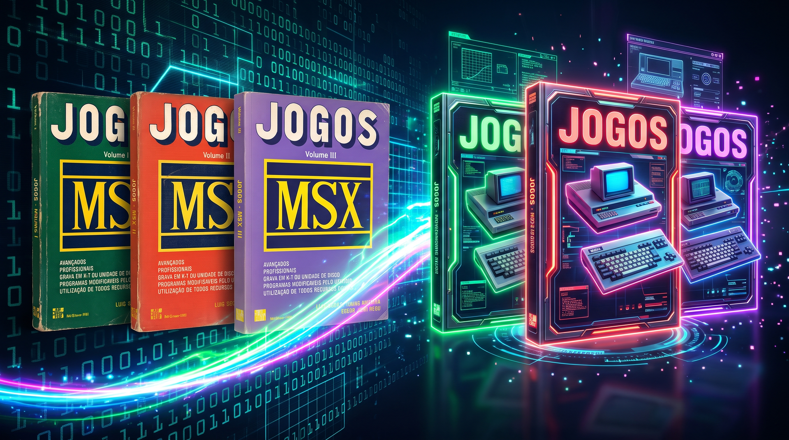
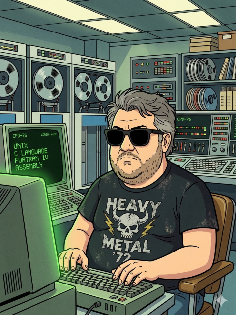

# MSX Jogos — Projeto de modernização



Este projeto revisita a coleção **MSX Jogos — Para Aprender e Criar e Jogos Profissionais**, publicada pela **McGraw-Hill nos anos 1980**, trazendo seus programas para um fluxo de trabalho atual sem perder de vista o computador e o espírito para os quais foram criados. A proposta é preservar e estudar os jogos originais, modernizar sua apresentação e, quando fizer sentido, experimentar novos recursos.

Os livros foram obtidos por meio do projeto **MSX Livros**, de **Alexandre Antoniutti**. A digitalização e a organização dos textos tornam possível consultar os sumários e trabalhar novamente com este material histórico. Nosso agradecimento a Alexandre e a todos que ajudam a preservar a memória do MSX.

## Versão 0.1.0

A primeira versão disponibiliza o menu do Volume I e o Cassino modernizado;
os demais jogos aparecem no menu, mas ainda não estão disponíveis.
Baixe o pacote de disco em [releases](https://github.com/wilsonpilon/msx-livro-de-jogos/releases/tag/v0.1.0),
extraia seus arquivos para um disco MSX e inicialize-o no drive A. O pacote
contém `AUTOEXEC.BAS`, `MENU.BMX` e `CASSINO.BMX`; não é uma imagem `.dsk`.
Consulte as [novidades da versão](./CHANGELOG.md) e as
[instruções do menu](./Volume-I/menu.md).

## Como estamos trabalhando

Esta remodelagem combina ferramentas de inteligência artificial com pesquisa, testes e **inferência própria**. Gemini, Claude e GitHub Copilot são usados como assistentes para explorar ideias, apoiar a leitura e a organização do material e auxiliar no desenvolvimento. As decisões sobre interpretação do original, comportamento esperado, adaptações e prioridades são avaliadas por mim — a IA é apoio ao trabalho, não substitui essa análise nem a validação dos programas.

O ambiente principal de desenvolvimento é o **Visual Studio Code**. Os programas estão sendo escritos no dialeto da **Basic Dignified Suite**, que permite trabalhar com um estilo mais legível e organizado e gerar BASIC compatível com o ambiente clássico do MSX. A intenção é manter o código acessível a quem quer aprender, estudar e modificar os jogos.

### Ferramentas

- [**Gemini**](https://gemini.google.com/) — assistência de IA para pesquisa, exploração de ideias e apoio ao trabalho.
- [**Claude**](https://claude.ai/) — assistência de IA para análise e desenvolvimento.
- [**GitHub Copilot**](https://github.com/features/copilot) — assistência de IA integrada ao fluxo de desenvolvimento.
- [**Visual Studio Code**](https://code.visualstudio.com/) — editor e ambiente de desenvolvimento.
- [**Basic Dignified Suite**](https://github.com/farique1/basic-dignified) — ferramentas e dialeto usados para escrever e preparar os programas em BASIC.
- **SDCC** e [**MSXgl**](https://github.com/aoineko-fr/MSXgl) — ferramentas consideradas para eventuais versões em C: o compilador SDCC e a biblioteca MSXgl para desenvolvimento no MSX.

## Menu do Volume I

O [menu em Basic Dignified](./Volume-I/menu.dmx) apresenta os 15 jogos do
sumário em duas categorias, com molduras duplas e seleção em vídeo inverso
em `SCREEN 0`. Use as **setas** para escolher, **Enter** para executar e
**Esc** para sair. O [disco](./Volume-I/disk/) contém `MENU.BMX` e
[AUTOEXEC.BAS](./Volume-I/disk/autoexec.bas) para carregar o menu no boot.
Por enquanto, apenas o Cassino está disponível; arquivos ausentes geram
um aviso sem fechar o menu. Veja [instruções e nomes dos arquivos](./Volume-I/menu.md).

## Modernização das listagens: Cassino

As listagens originais são preservadas como referência e retrabalhadas para facilitar a leitura, a manutenção e a evolução do jogo. O exemplo abaixo é a listagem numerada original de [cassino.bas](./Volume-I/cassino.bas), com 31 linhas:

```basic
10 REM -- CASSINO
20 SCREEN0:F=RND(-TIME)
30 FORI=1TOF:Y=RND(1):NEXT
40 PRINT:INPUT"QUANTIA INICIAL :";P
50 COLOR13,14:CLS
60 FORI=1TO3
70 LOCATE4+7*I,5:PRINT"+---+":LOCATE4+7*I,6:PRINT"!   !":LOCATE4+7*I,7:PRINT"+---+"
80 NEXTI
90 LOCATE13,6:PRINT" ":LOCATE20,6:PRINT" ":LOCATE27,6:PRINT" "
100 LOCATE0,11:INPUT"SUA APOSTA :";M
110 IFM=0ORM>PTHEN290
120 GOSUB270
130 A=X
140 GOSUB270
150 B=X
160 GOSUB270
170 LOCATE12,6:PRINTA:LOCATE19,6:PRINTB:LOCATE26,2:PRINTX
180 IFA=BANDA=XTHEN240
190 N=-M
200 LOCATE0,11:PRINT"APOSTA :";M;" - RESULTADO :";N;"    "
210 PRINT:PRINT"PRESSIONE UMA TECLA":R$=INPUT$(1)
220 P=P+N
230 GOTO50
240 N=M*50
250 IFA=7THENN=M*500
260 GOTO200
270 X=INT(RND(1)*9+1):PLAY"L32A"
280 RETURN
290 CLS
300 PRINT"VOCE TEM ";P
310 PRINT"ATE LOGO.":PLAY"CDEFG"
```

Essa listagem é a base histórica, não uma conversão automática linha por linha. A versão modernizada em [cassino.dmx](./Volume-I/cassino.dmx) reorganiza o fluxo em blocos identificados por rótulos, troca nomes curtos por nomes descritivos e separa tarefas em rotinas. Também amplia a apresentação, a animação dos rolos e os efeitos sonoros. Por isso, a lógica central do cassino permanece reconhecível, mas a experiência e a estrutura do programa foram desenvolvidas além do original.

### Mudanças nos gráficos

Na listagem original, os rolos são desenhados com caracteres simples (`+---+` e `!   !`) e ocupam poucas posições da tela. A versão modernizada monta uma moldura para a tela de 32 colunas em `SCREEN 1` usando os caracteres gráficos internacionais do MSX, representados por `chr$(1)` seguido dos códigos 86 a 91. A moldura é desenhada por uma rotina própria e reutilizada na abertura, nas rodadas e na tela de encerramento.

Os três rolos também ganham caixas alinhadas, áreas separadas para saldo, aposta e resultado, instruções na tela e mensagens contextuais. Durante o sorteio, cada rolo mostra uma sequência curta de símbolos em movimento antes de parar. A tabela de cores de `SCREEN 1` separa molduras ciano, números amarelos, letras uniformemente brancas e desenhos verdes sobre azul, respeitando os grupos de oito códigos ASCII. O prêmio máximo muda o fundo geral para azul, sem mudar a cor das letras.

As molduras têm linhas duplas e quatro cantos personalizados em 8×8,
inspirados nos quadros dos PCs clássicos. A paleta de grupos é reaplicada
após cada `COLOR`, para não perder as cores durante as etapas do jogo.
Veja [molduras e cores](./Volume-I/cassino.md#molduras-duplas).

A linha das teclas de função permanece oculta com `KEY OFF`. Ao terminar
uma partida, **S** inicia novamente pela abertura e pede um novo saldo;
**N** limpa a tela e devolve o controle ao BASIC em `SCREEN 0`,
`WIDTH 40` e `COLOR 15,1,1`.

Dez padrões de 8×8 pixels redefinem os caracteres 128–137: moeda (reservada),
cerejas, limão, sino, diamante, estrela, coração, sete, carro e nave.
Os desenhos são gravados com `VPOKE` na tabela de padrões `BASE(7)`.
O sorteio permanece de 1 a 9 e exibe `chr$(128 + numero_sorteado)`,
mantendo nove símbolos equiprováveis e o jackpot de três setes naturais. Veja a
[tabela de símbolos](./Volume-I/cassino.md#símbolos-dos-rolos).

```basic
rem -- Graficos internacionais: prefixo chr$(1), codigos 86 a 91.
vertical$ = chr$(1) + chr$(86)
horizontal$ = chr$(1) + chr$(87)
canto_superior_esquerdo$ = chr$(1) + chr$(88)
canto_superior_direito$ = chr$(1) + chr$(89)
canto_inferior_esquerdo$ = chr$(1) + chr$(90)
canto_inferior_direito$ = chr$(1) + chr$(91)
```

### Mudanças no som

No original, o giro toca um efeito curto (`PLAY "L32A"`) e a saída toca uma sequência simples (`PLAY "CDEFG"`). Na versão modernizada, os sons acompanham diferentes eventos: a abertura tem uma pequena música, cada passo do giro recebe um clique e o fim do giro tem um som próprio. Perdas, acertos comuns, prêmio máximo e encerramento também têm sequências distintas. As instruções `PLAY` passam parâmetros de andamento, oitava, volume e duração; várias sequências são tocadas em paralelo pelos canais do PSG do MSX.

```basic
play "t255o5v8l64c"
play "t255o6v10l32g"
play "t200o5v12l8cego6c4", "t200o4v8l4ceg2", "t200o3v6l4cgr2"
```

Por exemplo, a preparação da semente aleatória, antes condensada nas linhas 20–30, fica mais clara no Dignified:

```basic
screen 1
width 32
key off
color 11, 1, 1
gosub {aplicar_cores}
gosub {definir_simbolos}
semente_aleatoria = rnd(-time)
for indice = 1 to semente_aleatoria
    descarte_aleatorio = rnd(1)
next
```

E as linhas numeradas e saltos do original dão lugar a rótulos e desvios legíveis. O giro, por exemplo, passa a ser uma rotina reutilizável:

```basic
{sortear_numero}
    for passo_giro = 1 to 8
        numero_sorteado = int(rnd(1) * 9 + 1)
        locate coluna_rolo, 8
        print chr$(128 + numero_sorteado);
        play "t255o5v8l64c"
    next passo_giro
    play "t255o6v10l32g"
    return
```

O arquivo `.dmx` é o código-fonte legível no dialeto Basic Dignified. A suíte converte esse código para BASIC numerado de MSX (arquivo `.amx`), que pode então ser tokenizado e executado no computador ou emulador. Assim, a transformação do projeto é: listagem original `.bas` como referência → fonte modernizado `.dmx` → BASIC MSX gerado. O `.dmx` completo e a listagem original podem ser consultados nos links acima.

Saldo e aposta usam agora o [editor compartilhado de entrada](./include/entrada.dmx),
baseado em `inkey$`, para não interpretar as molduras como parte dos valores.
Há suporte a setas, sobrescrita, Insert, DEL e Backspace. As instruções de uso,
reutilização em outros jogos e testes no openMSX estão em
[Cassino — entrada e edição](./Volume-I/cassino.md#entrada-e-edição-dos-valores).

### Novas regras e estratégia

A abertura agora explica os pagamentos e os controles em duas páginas.
Cerejas pagam 1×/3×/10×, joias misturadas pagam 2×, trincas comuns 3×
e 777 natural 40×. A nave é curinga: dobra trincas comuns; dois setes
com nave e três naves pagam 10×. Só vale o maior prêmio.
Todos os pagamentos incluem a aposta, descontada uma vez por giro.

Após perdas, há chance de 1/12 de receber **Hold** para travar até dois
rolos no próximo giro pago, com a mesma aposta e sem ofertas consecutivas.
Qualquer prêmio permite uma tentativa opcional de **dobro ou nada**,
Cara/Coroa com 50% de chance. **Nudge não foi incluído.**

O retorno teórico é 92,18% sem Hold e cerca de 97,09% com uso ótimo do Hold
e aposta fixa. A tabela completa, as prioridades e os testes de todas as
729 combinações estão nas [regras do Cassino](./Volume-I/cassino.md#tabela-de-prêmios-conforme-o-código).

## Listagem completa de `cassino.dmx`

Abaixo está a listagem integral atual do fonte em Basic Dignified para MSX:

```basic
rem -- CASSINO

dim simbolo_rolo(3), rolo_travado(3)
goto {inicializar}

{entrada_numero}
    em = 1
    goto {entrada_campo}

{entrada_texto}
    em = 0

{entrada_campo}
    include "..\include\entrada.dmx"

{avaliar_combinacao}
    include "..\include\premios.dmx"

{inicializar}
screen 1
width 32
key off
color 11, 1, 1
gosub {aplicar_cores}
gosub {definir_simbolos}
hold_disponivel = 0
aposta_anterior = 0
for indice = 1 to 3
    simbolo_rolo(indice) = 0
    rolo_travado(indice) = 0
next indice
semente_aleatoria = rnd(-time)
for indice = 1 to semente_aleatoria
    descarte_aleatorio = rnd(1)
next

rem -- Molduras duplas: prefixo chr$(1), codigos 86 a 91.
vertical$ = chr$(1) + chr$(86)
horizontal$ = chr$(1) + chr$(87)
canto_superior_esquerdo$ = chr$(1) + chr$(88)
canto_superior_direito$ = chr$(1) + chr$(89)
canto_inferior_esquerdo$ = chr$(1) + chr$(90)
canto_inferior_direito$ = chr$(1) + chr$(91)
linha_horizontal$ = ""
for indice = 1 to 28
    linha_horizontal$ = linha_horizontal$ + horizontal$
next
topo_rolo$ = canto_superior_esquerdo$
base_rolo$ = canto_inferior_esquerdo$
for indice = 1 to 5
    topo_rolo$ = topo_rolo$ + horizontal$
    base_rolo$ = base_rolo$ + horizontal$
next
topo_rolo$ = topo_rolo$ + canto_superior_direito$
base_rolo$ = base_rolo$ + canto_inferior_direito$

{abertura}
    gosub {desenhar_moldura}
    locate 3, 5
    print "Aposta paga a cada giro."
    locate 3, 6
    print "Premios incluem a aposta."
    locate 3, 8
    print chr$(129); " no rolo 1: 1x"
    locate 3, 9
    print "Duas "; chr$(129); ": 3x; tres: 10x"
    locate 3, 11
    print "Tres iguais: 3x"
    locate 3, 12
    print "Tres setes: 40x"
    locate 3, 13
    print "Joias "; chr$(132); chr$(133); chr$(134); " mistas: 2x"
    locate 3, 14
    print "Nave "; chr$(137); " substitui simbolos."
    locate 3, 15
    print "Dobra as trincas comuns."
    locate 3, 16
    print "Dois 7 + "; chr$(137); ": 10x"
    locate 3, 17
    print "Tres "; chr$(137); ": 10x"
    locate 3, 19
    print "Vale o maior premio."
    locate 3, 20
    print "Tecla: controles";
    play "t180o5v10l8cego6c4", "t180o3v7l4cge2"
    tecla$ = input$(1)
    gosub {desenhar_moldura}
    locate 3, 5
    print "Hold apos perder: 1/12"
    locate 3, 7
    print "1/2/3: trava ate 2 rolos."
    locate 3, 8
    print "ENTER: confirma Hold."
    locate 3, 9
    print "Mesma aposta; giro pago."
    locate 3, 11
    print "Sem ofertas consecutivas."
    locate 3, 13
    print "Dobro ou nada: S/N."
    locate 3, 14
    print "1=Cara, 2=Coroa; 50%."
    locate 3, 15
    print "Uma tentativa por premio."
    locate 3, 17
    print "Zero/acima do saldo: sair."
    locate 3, 20
    print "Pressione uma tecla";
    tecla$ = input$(1)
    color 15, 1, 1
    gosub {aplicar_cores}
    gosub {desenhar_moldura}
    locate 3, 8
    print "Saldo: ";
    ec = 10
    el = 8
    et = 14
{ler_saldo}
    gosub {entrada_numero}
    if ev# < 0 then beep: goto {ler_saldo}
    saldo = ev#

{iniciar_rodada}
    color 10, 1, 1
    gosub {aplicar_cores}
    gosub {desenhar_moldura}
    for indice = 1 to 3
        coluna_rolo = 3 + (indice - 1) * 9
        locate coluna_rolo, 7
        print topo_rolo$;
        locate coluna_rolo, 8
        print vertical$; "     "; vertical$;
        locate coluna_rolo, 9
        print base_rolo$;
        if simbolo_rolo(indice) > 0 then locate coluna_rolo + 3, 8: print chr$(128 + simbolo_rolo(indice));
    next indice

    locate 3, 11
    print "Saldo :"; saldo
    locate 3, 18
    if hold_disponivel then print "Hold: mesma aposta, pago" else print "Aposte zero para encerrar"
    locate 3, 13
    print "Sua aposta: ";
    ec = 15
    el = 13
    et = 14
{ler_aposta}
    gosub {entrada_numero}
    if ev# < 0 then beep: goto {ler_aposta}
    aposta = ev#
    if aposta = 0 or aposta > saldo then {encerrar}

    rodada_com_hold = hold_disponivel
    hold_disponivel = 0
    quantidade_travados = 0
    for indice = 1 to 3
        rolo_travado(indice) = 0
    next indice
    if rodada_com_hold and aposta = aposta_anterior then gosub {escolher_hold}
    if rodada_com_hold and aposta <> aposta_anterior then locate 3, 18: print "Hold cancelado: nova aposta";: beep
    saldo = saldo - aposta
    color 11, 1, 1
    gosub {aplicar_cores}
    locate 3, 16
    print space$(26);
    locate 3, 16
    print "Girando...";
    for indice = 1 to 3
        if rolo_travado(indice) = 0 then coluna_rolo = 6 + (indice - 1) * 9: gosub {sortear_numero}: simbolo_rolo(indice) = numero_sorteado
    next indice
    ra = simbolo_rolo(1)
    rb = simbolo_rolo(2)
    rc = simbolo_rolo(3)
    gosub {avaliar_combinacao}
    premio = aposta * pm
    mensagem_resultado$ = mp$
    if pm > 0 then gosub {dobro_ou_nada}
    resultado = premio - aposta
    if premio = 0 then color 8, 1, 1 else if jp then color 10, 4, 4 else color 3, 1, 1
    gosub {aplicar_cores}
    if premio = 0 then play "t160o4v9l8gec4", "t160o3v6l4cr4" else play "t200o5v12l8cego6c4", "t200o4v8l4ceg2"

{mostrar_resultado}
    saldo = saldo + premio
    aposta_anterior = aposta
    if pm = 0 and rodada_com_hold = 0 and saldo > 0 then if int(rnd(1) * 12) = 0 then hold_disponivel = 1
    locate 3, 13
    print space$(26);
    locate 3, 13
    print "Aposta :"; aposta
    locate 3, 14
    print space$(26);
    locate 3, 14
    print "Premio:"; premio
    locate 3, 15
    print "Resultado:"; resultado
    locate 3, 16
    print space$(26);
    locate 3, 16
    print mensagem_resultado$;
    locate 3, 18
    print space$(26);
    locate 3, 18
    print "Saldo: "; saldo
    locate 3, 19
    print space$(26);
    if hold_disponivel then locate 3, 19: print "Hold: mantenha a aposta";
    locate 3, 20
    print "Pressione uma tecla";
    tecla$ = input$(1)
    goto {iniciar_rodada}

{escolher_hold}
    locate 3, 16
    print "1/2/3: trava; ENTER gira";
    locate 3, 18
    print space$(26);
    locate 3, 18
    print "Max. 2 rolos; giro pago";
{tecla_hold}
    tecla$ = inkey$
    if tecla$ = "" then {tecla_hold}
    if tecla$ = chr$(13) then return
    if tecla$ < "1" or tecla$ > "3" then beep: goto {tecla_hold}
    indice_hold = asc(tecla$) - 48
    if rolo_travado(indice_hold) = 0 and quantidade_travados = 2 then beep: goto {tecla_hold}
    rolo_travado(indice_hold) = 1 - rolo_travado(indice_hold)
    quantidade_travados = quantidade_travados + rolo_travado(indice_hold) * 2 - 1
    locate 3 + (indice_hold - 1) * 9, 10
    if rolo_travado(indice_hold) then print " TRAVA "; else print "       ";
    goto {tecla_hold}

{dobro_ou_nada}
    locate 3, 14
    print "Premio:"; premio
    locate 3, 16
    print mensagem_resultado$;
    locate 3, 18
    print space$(26);
    locate 3, 18
    print "Dobro ou nada? (S/N)";
{aceitar_dobro}
    tecla$ = inkey$
    if tecla$ = "" then {aceitar_dobro}
    if tecla$ = "n" or tecla$ = "N" then return
    if tecla$ <> "s" and tecla$ <> "S" then beep: goto {aceitar_dobro}
    locate 3, 19
    print "1=Cara / 2=Coroa";
{escolher_moeda}
    tecla$ = inkey$
    if tecla$ = "" then {escolher_moeda}
    if tecla$ <> "1" and tecla$ <> "2" then beep: goto {escolher_moeda}
    lado_escolhido = asc(tecla$) - 49
    lado_sorteado = int(rnd(1) * 2)
    if lado_escolhido = lado_sorteado then premio = premio * 2: mensagem_resultado$ = "Acertou! Premio dobrado!" else premio = 0: mensagem_resultado$ = "Errou! Perdeu o premio."
    return

{sortear_numero}
    for passo_giro = 1 to 8
        numero_sorteado = int(rnd(1) * 9 + 1)
        locate coluna_rolo, 8
        print chr$(128 + numero_sorteado);
        play "t255o5v8l64c"
    next passo_giro
    play "t255o6v10l32g"
    return

{encerrar}
    color 11, 1, 1
    gosub {aplicar_cores}
    gosub {desenhar_moldura}
    locate 7, 7
    print "Obrigado por jogar!"
    locate 3, 10
    print "Voce tem :"; saldo
    locate 3, 14
    print "Jogar novamente? (S/N)";
    play "t160o5v10l8gec4", "t160o3v7l4gc2"

{perguntar_reinicio}
    tecla$ = inkey$
    if tecla$ = "" then {perguntar_reinicio}
    if tecla$ = "s" or tecla$ = "S" then {inicializar}
    if tecla$ = "n" or tecla$ = "N" then {voltar_basic}
    beep
    goto {perguntar_reinicio}

{voltar_basic}
    screen 0
    width 40
    color 15, 1, 1
    key off
    cls
    end

{desenhar_moldura}
    cls
    locate 1, 1
    print canto_superior_esquerdo$; linha_horizontal$; canto_superior_direito$;
    for linha_tela = 2 to 21
        locate 1, linha_tela
        print vertical$;
        locate 30, linha_tela
        print vertical$;
    next linha_tela
    locate 1, 22
    print canto_inferior_esquerdo$; linha_horizontal$; canto_inferior_direito$;
    locate 11, 3
    print "Cassino MSX";
    return

{aplicar_cores}
    endereco_cores = base(6)
    fundo_texto = peek(&hf3ea)
    vpoke endereco_cores + 2, 7 * 16 + fundo_texto
    vpoke endereco_cores + 3, 7 * 16 + fundo_texto
    for grupo_cor = 4 to 15
        vpoke endereco_cores + grupo_cor, 15 * 16 + fundo_texto
    next grupo_cor
    for grupo_cor = 6 to 7
        vpoke endereco_cores + grupo_cor, 10 * 16 + fundo_texto
    next grupo_cor
    vpoke endereco_cores + 16, &h34
    vpoke endereco_cores + 17, &h34
    return

{definir_simbolos}
    restore {dados_moldura}
    for codigo_simbolo = 22 to 27
        gosub {carregar_padrao}
    next codigo_simbolo
    restore {dados_simbolos}
    for codigo_simbolo = 128 to 137
        gosub {carregar_padrao}
    next codigo_simbolo
    return

{carregar_padrao}
    for linha_simbolo = 0 to 7
        read padrao_simbolo
        vpoke base(7) + codigo_simbolo * 8 + linha_simbolo, padrao_simbolo
    next linha_simbolo
    return

{dados_moldura}
    rem -- 22: Vertical dupla.
    data &b00100100, &b00100100, &b00100100, &b00100100, &b00100100, &b00100100, &b00100100, &b00100100
    rem -- 23: Horizontal dupla.
    data &b00000000, &b00000000, &b11111111, &b00000000, &b00000000, &b11111111, &b00000000, &b00000000
    rem -- 24: Canto superior esquerdo.
    data &b00000000, &b00000000, &b00111111, &b00100000, &b00100000, &b00100111, &b00100100, &b00100100
    rem -- 25: Canto superior direito.
    data &b00000000, &b00000000, &b11111100, &b00000100, &b00000100, &b11100100, &b00100100, &b00100100
    rem -- 26: Canto inferior esquerdo.
    data &b00100100, &b00100100, &b00100111, &b00100000, &b00100000, &b00111111, &b00000000, &b00000000
    rem -- 27: Canto inferior direito.
    data &b00100100, &b00100100, &b11100100, &b00000100, &b00000100, &b11111100, &b00000000, &b00000000

{dados_simbolos}
    rem -- 128: Moeda (reservada).
    data &b00111100, &b01000010, &b10011001, &b10100101, &b10100101, &b10011001, &b01000010, &b00111100
    rem -- 129: Cerejas.
    data &b00001100, &b00011000, &b00101000, &b01000100, &b11101110, &b11101110, &b01000100, &b00000000
    rem -- 130: Limao.
    data &b00000000, &b00111100, &b01111110, &b11111111, &b11111111, &b01111110, &b00111100, &b00000000
    rem -- 131: Sino.
    data &b00011000, &b00111100, &b00111100, &b00111100, &b01111110, &b01111110, &b11111111, &b00011000
    rem -- 132: Diamante.
    data &b00000000, &b00111100, &b01111110, &b11111111, &b01111110, &b00111100, &b00011000, &b00000000
    rem -- 133: Estrela.
    data &b00011000, &b00011000, &b11111111, &b01111110, &b00111100, &b01111110, &b01100110, &b01000010
    rem -- 134: Coracao.
    data &b00000000, &b01100110, &b11111111, &b11111111, &b01111110, &b00111100, &b00011000, &b00000000
    rem -- 135: Sete (premio maximo).
    data &b00000000, &b01111110, &b00000110, &b00001100, &b00011000, &b00110000, &b00110000, &b00000000
    rem -- 136: Carro.
    data &b00000000, &b00111100, &b01000010, &b11111111, &b11111111, &b01100110, &b01100110, &b00000000
    rem -- 137: Nave.
    data &b00011000, &b00111100, &b00111100, &b01111110, &b11111111, &b11011011, &b00011000, &b00100100
```

## Os volumes

Os títulos abaixo seguem os sumários dos três livros. Não há um link separado para cada jogo: esta lista serve como visão geral da coleção e do material em processo de modernização.

### Volume I

**Cassino**, **Batalha Naval**, **Gorks**, **Vinte e Um**, **Roleta**, **O Eletricista Louco**, **Frogger**, **Tubarão!**, **O Jogo do Cemitério**, **Fórmula Um**, **Poker Profissional**, **Trem Maluco**, **Caple**, **Fórmula Interlagos** e **Labirinto Tridimensional**.

### Volume II

**O Indesejável**, **Poker**, **Prestidigitador**, **Máquina de Palavras**, **Letras**, **Loteria**, **Gênio Musical**, **Luna Um**, **Raposa**, **Pesca Piranha**, **Vinte e Um**, **Guerra dos Mundos**, **Decida-se!**, **Montador**, **Packman Sinistro** e **Capture os Mongas**.

### Volume III

**Quente, Frio**, **O Jogo da Vida**, **O Enforcado**, **Corrida de Cavalos**, **Destreza**, **Meteorito Espacial**, **Fujão**, **Fórmula 1 Suicida**, **Barreira**, **Invasores Espaciais**, **Rocky Rock** e **Torre do Mistério**. O volume também apresenta os programas **Gráficos**, **Caixa de Música**, **Bach** e **Dança do Inseto**; **Montador** aparece no sumário como utilitário, não como jogo.

## Possíveis versões e novos recursos

O foco é a versão em BASIC para MSX, mas algumas ideias podem ganhar adaptações: certos jogos poderão ser portados para **MSX 2**, com recursos de **som FM**, ou receber duas versões para diferentes configurações. Um ou outro também poderá ser refeito em **C**, usando **SDCC + MSXgl**. Essas possibilidades dependem da viabilidade de cada jogo e não significam que todas as versões já estejam implementadas.

## Progresso e imagens

Este README acompanhará a evolução do projeto. Conforme os jogos forem sendo desenvolvidos e testados, serão acrescentados detalhes, observações e screenshots para mostrar o código e os resultados em execução.

## Créditos

- **Oscar Júlio Burd** e **Luiz Sérgio Young Moreira** — autores dos livros originais.
- **McGraw-Hill** — editora da coleção original.
- **Alexandre Antoniutti** e o projeto **MSX Livros** — fonte dos livros utilizados nesta iniciativa de preservação e modernização.
- **Farique** — autor da **Basic Dignified Suite**.
- **SDCC** — compilador C para microcontroladores e sistemas embarcados, considerado para possíveis versões em C.
- **Aoinéko** — autor do **MSXgl**, considerado para possíveis versões em C para MSX.
- **Google/Gemini**, **Anthropic/Claude**, **GitHub Copilot** e **Microsoft/Visual Studio Code** — ferramentas utilizadas como apoio ao desenvolvimento.

Este trabalho é uma iniciativa independente de preservação e modernização, inspirada na coleção original. Os créditos aos autores, à editora, às ferramentas e às fontes do material são mantidos em reconhecimento às suas contribuições.

## Manifesto pessoal

---



## ⚠️ Manifesto do Repositório: Projetos Estritamente Pessoais ⚠️

> *Se você tropeçou neste GitHub ou site, saiba que provavelmente foi por acidente, já que eu não faço a menor questão de divulgar o que construo por aqui.*

Este espaço é o meu **asilo digital**. Aqui você vai encontrar uma coleção caótica de utilitários, ferramentas, linguagens, jogos e remakes voltados para MSX, ZX-81, ZX-Spectrum e IBM-PC clássico. Antes que você comece a analisar o código ou tentar rodar alguma coisa, vamos deixar as expectativas bem alinhadas:

* 🛑 **Inutilidade Pública:** Estes projetos são de cunho estritamente pessoal. Em momento algum a minha ideia foi criar algo inovador, revolucionário ou "útil de verdade" para a humanidade. Eles existem única e exclusivamente porque me interessam.

* 🤷‍♂️ **Garantia Zero (As-Is):** Se, por algum milagre, você achar algo útil no meio disso tudo, sinta-se à vontade para usar, clonar ou modificar. Mas fique avisado: **não há absolutamente nenhuma garantia**. Se rodar, ótimo. Se queimar a sua máquina, o problema é seu.

* 🤖 **Código, IA e Terapia:** Não tenho a menor vergonha de misturar o meu próprio conhecimento de décadas com Inteligência Artificial para fazer as coisas funcionarem. O motivo é simples: isso aqui é para diversão e alívio de estresse. Estes projetos funcionam como a minha **terapia pessoal** para lidar com problemas de saúde física e mental. O objetivo final é o meu bem-estar, não a perfeição algorítmica ou agradar puristas.

* 🚫 **Ouvidoria Fechada:** Sugestões? Elas podem (ou não) ser bem-vindas, dependendo puramente do meu humor no dia. Já as críticas e "cagadas de regra", peço a gentileza de que as guarde com muito carinho para si mesmo. Se achou o código ineficiente, mal documentado ou fora dos seus padrões, recomendo fortemente que você abra o seu próprio editor, faça melhor do zero e seja muito feliz no seu próprio repositório.

---

> *Resumindo: minha única intenção é curtir meus projetos em paz e no meu próprio ritmo. Aproveite o código (ou não) e siga o seu rumo.* ✌️

---