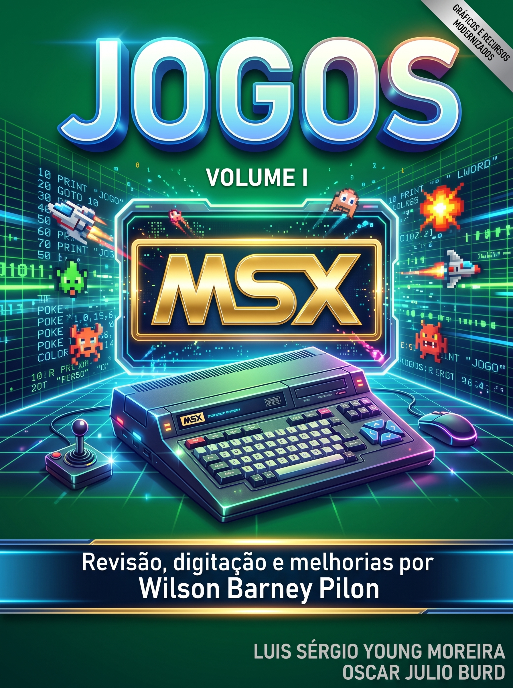

# MSX Jogos

## Para Aprender e Criar e Jogos Profissionais

**Autores:** Oscar Júlio Burd e Luiz Sérgio Young Moreira

*Edição revisada, ampliada e melhorada por Wilson "Barney" Pilon*

# O LIVRO

Este livro foi dividido em duas partes: a primeira destina-se àqueles jogadores que gostam de programar e desejam colocar um "pouco" de imaginação e criatividade nos jogos. Nesta primeira parte estão jogos simples, de fácil compreensão com um pouco de estudo e conhecimento de Basic do MSX.

Com estes atributos, a primeira parte, que denominamos de "JOGOS PARA APRENDER E CRIAR", é ideal para programadores iniciantes, que poderão ampliar e melhorar estes jogos. Para ajudar, colocamos em cada jogo algumas sugestões de modificações possíveis.

A segunda parte contém o que denominamos de "JOGOS PROFISSIONAIS". Este nome advém do fato de que estes jogos são altamente elaborados, comparando-se com os jogos que são comercializados para o MSX em fita cassete e cartucho. Um grande atributo destes jogos é que a maioria será compreendida por você mais cedo ou mais tarde..., quando, então, poderá alterá-los a seu gosto.

Cabe notar que todos os jogos possuem recursos sonoros ... não esqueça de aumentar o volume (mas lembre-se dos vizinhos!).

Boa sorte!

# SUMÁRIO

## Parte I: JOGOS PARA APRENDER E CRIAR

- [CASSINO](cassino.md)
- [BATALHA NAVAL](batalha-naval.md)
- [GORKS](gorks.md)
- [VINTE E UM](vinte-e-um.md)
- [ROLETA](roleta.md)
- [O ELETRICISTA LOUCO](o-eletricista-louco.md)

## Parte II: JOGOS PROFISSIONAIS

- [FROGGER](frogger.md)
- [TUBARÃO!](tubarao.md)
- [O JOGO DO CEMITÉRIO](o-jogo-do-cemiterio.md)
- [FÓRMULA UM](formula-um.md)
- [POKER PROFISSIONAL](poker-profissional.md)
- [TREM MALUCO](trem-maluco.md)
- [CAPLE](caple.md)
- [FÓRMULA INTERLAGOS](formula-interlagos.md)
- [LABIRINTO TRIDIMENSIONAL](labirinto-tridimensional.md)