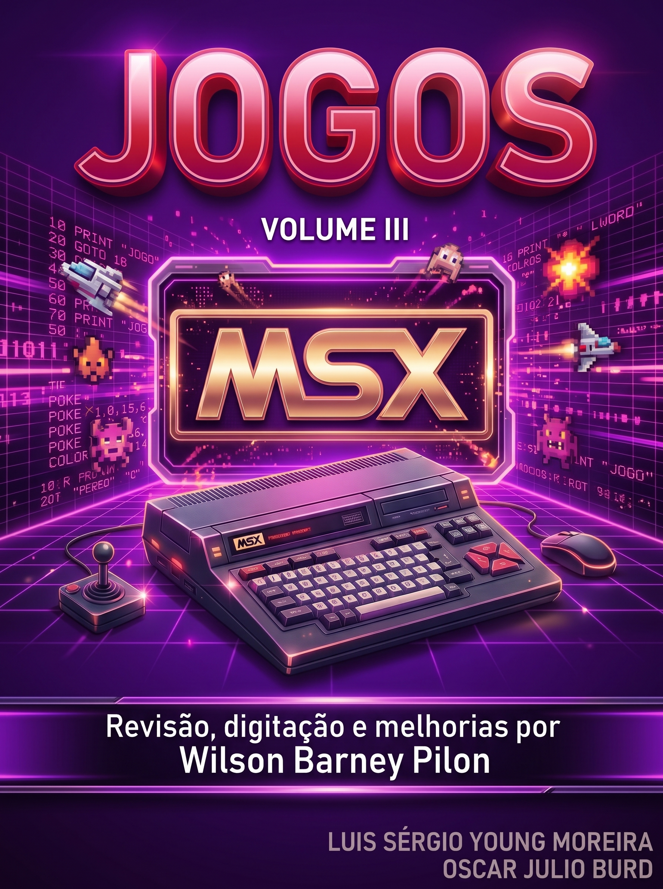

# MSX Jogos

## Para Aprender e Criar e Jogos Profissionais

**Autores:** Oscar Júlio Burd e Luiz Sérgio Young Moreira

*Edição revisada, ampliada e melhorada por Wilson "Barney" Pilon*

# O LIVRO

Este livro foi dividido em duas partes: a primeira destina-se àqueles jogadores que gostam de programar e desejam colocar um "pouco" de imaginação e criatividade nos jogos. Nesta primeira parte estão os jogos simples, de fácil compreensão com um pouco de estudo e conhecimento de Basic do MSX.

Com estes atributos, a primeira parte, que denominamos de "JOGOS PARA APRENDER E CRIAR", é ideal para programadores iniciantes, que poderão ampliar e melhorar este jogos. Para ajudar, colocamos em cada jogo algumas sugestões de modificações possíveis.

A segunda parte contém o que denominamos "JOGOS PROFISSIONAIS". Este nome advém do fato de que estes jogos são altamene elaborados, comparando-se com os jogos que são comercializados para o MSX em fita cassete e cartucho. Um grande atributo destes jogos é que a maioria será compreendida por você mais cedo ou mais tarde..., quando, então, poderá alterá-los a seu gosto.

Cabe notar que todos os jogos possuem recursos sonoros... não esqueça de aumentar o volume (mas lembre-se dos vizinhos!).

Boa sorte!

# SUMÁRIO

## Parte I: JOGOS PARA APRENDER E CRIAR

- [QUENTE, FRIO](quente-frio.md)
- [O JOGO DA VIDA](o-jogo-da-vida.md)
- [O ENFORCADO](o-enforcado.md)
- [CORRIDA DE CAVALOS](corrida-de-cavalos.md)
- [DESTREZA](destreza.md)
- [METEORITO ESPACIAL](meteorito-espacial.md)

## Parte II: JOGOS PROFISSIONAIS

- [FUJÃO](fujao.md)
- [FÓRMULA 1 SUICIDA](formula-1-suicida.md)
- [BARREIRA](barreira.md)
- [INVASORES ESPACIAIS](invasores-espaciais.md)
- [ROCKY ROCK](rocky-rock.md)
- [MONTADOR (\*)](montador-vol3.md)
- [TORRE DO MISTÉRIO](torre-do-misterio.md)

## Parte III: PROGRAMAS GRÁFICOS E MUSICAIS

- [GRÁFICOS](graficos.md)
- [CAIXA DE MÚSICA](caixa-de-musica.md)
- [BACH](bach.md)
- [DANÇA DO INSETO](danca-do-inseto.md)

(\*) Obs.: não é jogo; é um utilitário.